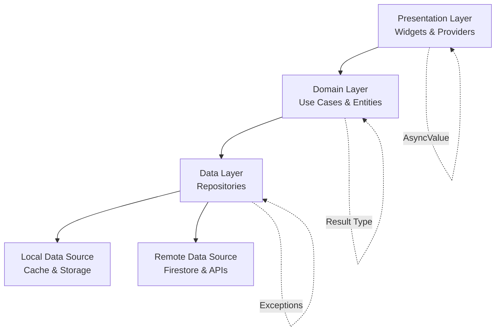
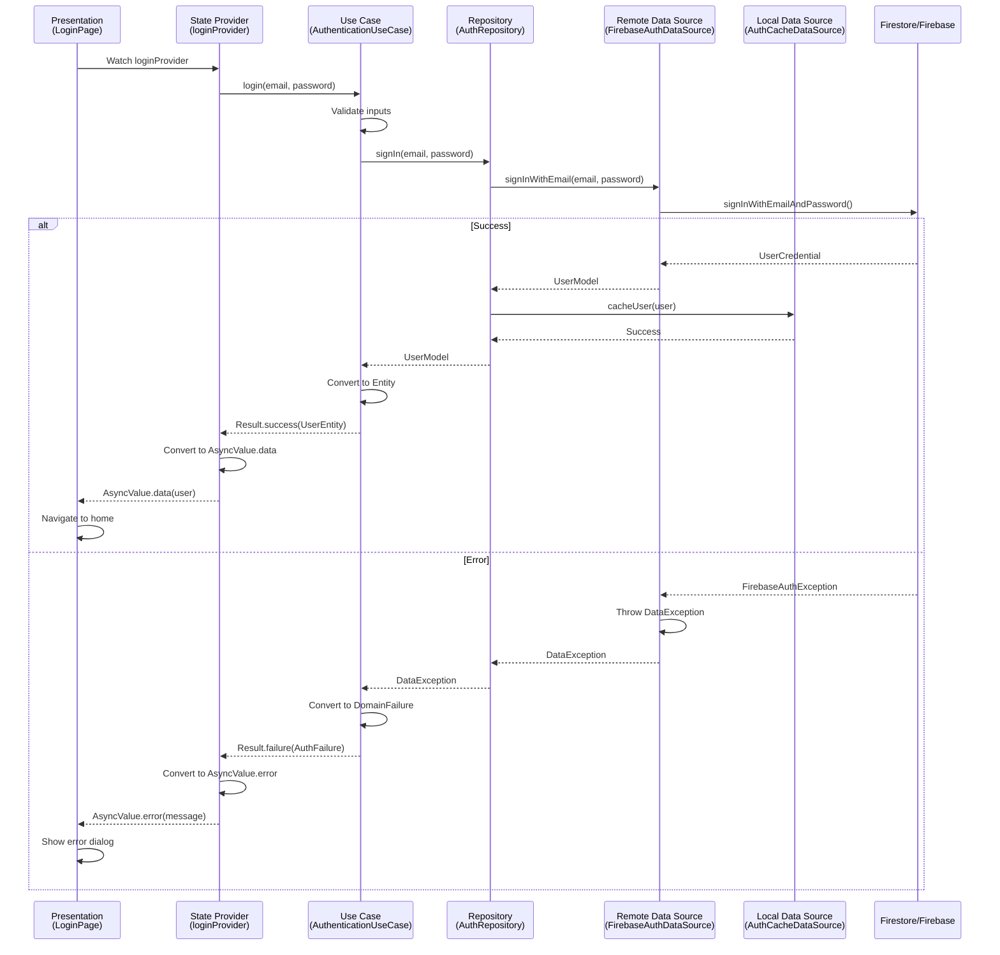
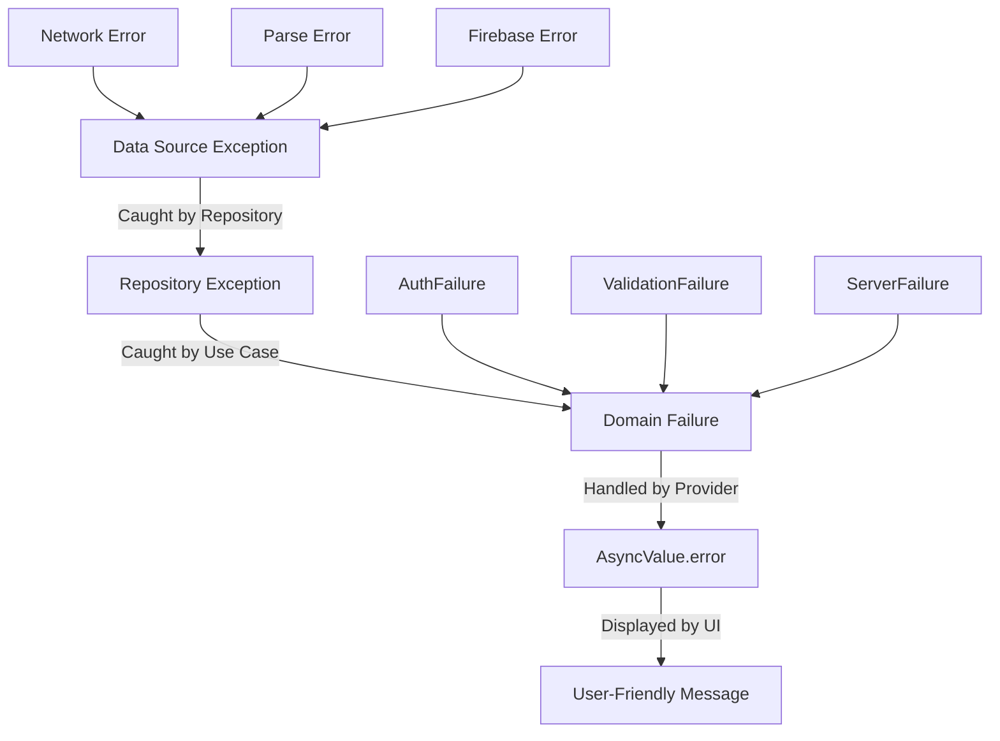

# Core Flows - Clean Architecture Migration

# Core Flows - Clean Architecture Migration

This document defines the key flows for migrating Zyntro from its current service-based architecture to clean architecture with proper layering, following a systematic layer-by-layer approach.

## Architecture Overview



**Key Principles:**

- **Feature-first structure**: Each feature contains its own domain, data, and presentation layers
- **Layer-by-layer migration**: Build repositories → use cases → UI migration
- **Gradual replacement**: Replace services while maintaining interfaces
- **Separate entities and models**: Domain entities are pure, data models handle serialization
- **Hybrid error handling**: Exceptions → Result types → AsyncValue

---

## Flow 1: Layer-by-Layer Migration Flow

**Description**: Systematic migration of a feature from current service-based architecture to clean architecture.

**Trigger**: Decision to migrate a feature (starting with Auth)

**Steps**:

### Phase 1: Data Layer Setup

1. **Create folder structure** for the feature
  - Create `lib/features/[feature]/data/` directory
  - Add subdirectories: `models/`, `datasources/`, `repositories/`
2. **Define data models** (DTOs)
  - Extract relevant models from file:lib/core/models/models.dart
  - Create separate model files with `fromFirestore()` and `toFirestore()` methods
  - Models handle all serialization logic
3. **Build data sources**
  - **RemoteDataSource**: Handles Firestore/API calls
    - Extract Firestore queries from existing service
    - Throw exceptions on errors (network, parsing, etc.)
    - No business logic, pure data fetching
  - **LocalDataSource**: Handles caching and local storage
    - Implement cache with TTL
    - Use SharedPreferences or Hive for persistence
    - Throw exceptions on cache errors
4. **Implement repository**
  - Create repository interface in domain layer (next phase)
  - Implement repository in data layer
  - Coordinate between local and remote data sources
  - Handle cache-first or network-first strategies
  - Catch data source exceptions, return them as-is
5. **Create providers** for data layer
  - Create `[feature]_providers.dart` in feature root
  - Define providers for data sources and repository
  - Use Riverpod's dependency injection

### Phase 2: Domain Layer Setup

1. **Create domain structure**
  - Create `lib/features/[feature]/domain/` directory
  - Add subdirectories: `entities/`, `repositories/`, `usecases/`
2. **Define entities**
  - Create pure domain entities (no serialization logic)
  - Entities represent business concepts
  - Immutable with copyWith methods
  - No dependencies on data layer
3. **Define repository interfaces**
  - Abstract repository contracts
  - Return types use Result<Success, Failure>
  - Define all data operations needed by use cases
4. **Build use cases**
  - Medium-grained: group related actions
  - Example: `AuthenticationUseCase` with `login()`, `logout()`, `refreshToken()`
  - Depend on repository interfaces, not implementations
  - Contain business logic and validation
  - Return Result<Entity, Failure> types
  - Transform repository exceptions into domain failures
5. **Create domain providers**
  - Add use case providers to `[feature]_providers.dart`
  - Wire up dependencies (use cases → repositories)

### Phase 3: Presentation Layer Migration

1. **Create presentation structure**
  - Keep existing `lib/features/[feature]/presentation/` directory
  - Add `providers/`, `widgets/`, `pages/` subdirectories if needed
2. **Build state providers**
  - Create Riverpod providers that call use cases
  - Use `FutureProvider` or `StreamProvider` as appropriate
  - Return `AsyncValue<Entity>` to UI
  - Handle Result types from use cases, convert to AsyncValue
3. **Update UI widgets**
  - Refactor existing pages to use new providers
  - Replace direct service calls with provider watches
  - Use AsyncValue pattern for loading/error/data states
  - Remove business logic from widgets
4. **Gradual service replacement**
  - Keep old service temporarily
  - Create adapter if needed for backward compatibility
  - Update one screen at a time
  - Remove old service once all screens migrated

### Phase 4: Testing & Validation

1. **Write unit tests**
  - Test data sources with mocked Firestore
  - Test repositories with mocked data sources
  - Test use cases with mocked repositories
  - Test providers with mocked use cases
2. **Write integration tests**
  - Test complete flows end-to-end
  - Verify data flows correctly through layers
  - Test error handling at each layer
3. **Validate migration**
  - All existing functionality works
  - No regressions in user experience
  - Performance is maintained or improved
  - Code is cleaner and more maintainable

**Exit**: Feature fully migrated to clean architecture, old service removed

---

## Flow 2: Data Flow Architecture

**Description**: How data flows through the new architecture layers during a typical operation.

**Example**: User logs in with email and password



**Key Points**:

- UI only knows about entities and AsyncValue
- Use cases contain business logic and validation
- Repository coordinates data sources
- Data sources handle technical details
- Errors transform at each layer boundary

---

## Flow 3: Error Handling Flow

**Description**: How errors propagate and transform across architectural layers.

**Trigger**: An error occurs at any layer

**Error Transformation**:



**Steps**:

1. **Data Source Layer** (Throws Exceptions)
  - Catches platform exceptions (Firebase, network, etc.)
  - Throws typed `DataException` with error details
  - Examples: `NetworkException`, `ServerException`, `CacheException`
2. **Repository Layer** (Passes Exceptions)
  - Catches data source exceptions
  - Logs errors for debugging
  - Re-throws exceptions to use case layer
  - No error transformation at this layer
3. **Use Case Layer** (Returns Result Types)
  - Catches repository exceptions
  - Transforms exceptions into domain failures
  - Returns `Result<Success, Failure>` types
  - Examples: `Result.failure(AuthFailure.invalidCredentials)`
  - Failures are domain-specific, not technical
4. **Provider Layer** (Converts to AsyncValue)
  - Calls use case methods
  - Handles Result types
  - On success: `AsyncValue.data(entity)`
  - On failure: `AsyncValue.error(failure.message)`
  - Provides user-friendly error messages
5. **UI Layer** (Displays Errors)
  - Watches AsyncValue from providers
  - Shows loading indicators for `AsyncValue.loading`
  - Displays error messages for `AsyncValue.error`
  - Renders data for `AsyncValue.data`
  - Uses consistent error UI components

**Exit**: Error is handled gracefully, user sees appropriate message

---

## Flow 4: New Feature Development Flow

**Description**: How to build a new feature using the clean architecture.

**Trigger**: Need to add a new feature to the app

**Steps**:

1. **Plan the feature**
  - Define entities (domain models)
  - Identify required data operations
  - List use cases (business operations)
  - Sketch UI screens
2. **Create folder structure**
  ```
   lib/features/[feature]/
   ├── domain/
   │   ├── entities/
   │   ├── repositories/
   │   └── usecases/
   ├── data/
   │   ├── models/
   │   ├── datasources/
   │   └── repositories/
   ├── presentation/
   │   ├── providers/
   │   ├── widgets/
   │   └── pages/
   └── [feature]_providers.dart
  ```
3. **Build from domain outward**
  - Start with entities (pure business objects)
  - Define repository interfaces (what data operations needed)
  - Create use cases (business logic)
  - Write unit tests for domain layer
4. **Implement data layer**
  - Create data models with serialization
  - Build remote data source (Firestore queries)
  - Build local data source (caching)
  - Implement repository (coordinates data sources)
  - Write tests for data layer
5. **Build presentation layer**
  - Create state providers (call use cases)
  - Build UI widgets (consume AsyncValue)
  - Create pages (compose widgets)
  - Write widget tests
6. **Wire up dependencies**
  - Define all providers in `[feature]_providers.dart`
  - Ensure proper dependency injection
  - Test integration between layers
7. **Add navigation**
  - Add routes to router configuration
  - Integrate with existing navigation flows
  - Test navigation paths

**Exit**: New feature is complete, tested, and integrated

---

## Flow 5: Gradual Service Replacement Flow

**Description**: How to replace old services while maintaining app functionality during migration.

**Trigger**: Starting migration of a feature that has an existing service

**Steps**:

1. **Analyze existing service**
  - Document all public methods
  - Identify dependencies on other services
  - List all places where service is used
  - Note any complex business logic
2. **Build new architecture in parallel**
  - Create data layer (repositories, data sources)
  - Create domain layer (use cases, entities)
  - Keep old service untouched initially
3. **Create compatibility layer** (if needed)
  - If old code needs to use new repositories temporarily
  - Create adapter that wraps new repository
  - Maintains old service interface
  - Delegates to new implementation
4. **Migrate UI incrementally**
  - Choose one screen/widget to migrate first
  - Update to use new providers instead of old service
  - Test thoroughly
  - Repeat for next screen
5. **Track migration progress**
  - Mark migrated screens in documentation
  - Keep list of remaining screens
  - Monitor for any issues
6. **Remove old service**
  - Once all screens migrated
  - Remove old service file
  - Remove service provider
  - Clean up any adapters
  - Update imports
7. **Verify cleanup**
  - Search codebase for old service references
  - Ensure no dead code remains
  - Run all tests
  - Verify app functionality

**Exit**: Old service completely removed, all functionality using new architecture

---

## Flow 6: Testing Flow

**Description**: Comprehensive testing strategy for each architectural layer.

**Trigger**: Code is written and ready for testing

**Steps**:

### Data Source Testing

1. **Mock external dependencies**
  - Mock Firestore using `fake_cloud_firestore`
  - Mock SharedPreferences using `shared_preferences_test`
2. **Test remote data source**
  - Test successful data fetching
  - Test error scenarios (network errors, parse errors)
  - Verify correct Firestore queries
  - Test exception throwing
3. **Test local data source**
  - Test cache storage and retrieval
  - Test cache expiration (TTL)
  - Test cache invalidation
  - Test error scenarios

### Repository Testing

1. **Mock data sources**
  - Use Mocktail to mock local and remote data sources
2. **Test repository logic**
  - Test cache-first strategy
  - Test network-first strategy
  - Test fallback to cache on network error
  - Test data source coordination
  - Verify exception propagation

### Use Case Testing

1. **Mock repositories**
  - Use Mocktail to mock repository interfaces
2. **Test business logic**
  - Test input validation
  - Test success scenarios
  - Test failure scenarios
  - Test Result type returns
  - Test domain failure creation

### Provider Testing

1. **Mock use cases**
  - Use Mocktail to mock use cases
2. **Test state management**
  - Test AsyncValue states (loading, data, error)
  - Test provider updates
  - Test error handling
  - Use `ProviderContainer` for testing

### Widget Testing

1. **Mock providers**
  - Override providers with test values
2. **Test UI behavior**
  - Test loading states display
  - Test error states display
  - Test data display
  - Test user interactions
  - Test navigation

### Integration Testing

1. **Test complete flows**
  - Test end-to-end user journeys
  - Use real Firestore emulator
  - Test error recovery
  - Test offline scenarios
2. **Verify layer integration**
  - Ensure data flows correctly
  - Verify error handling across layers
  - Test state updates propagate to UI

**Exit**: All layers tested, integration verified, confidence in code quality

---

## Migration Checklist

For each feature being migrated:

- [ ] **Data Layer**
  - [ ] Data models created with serialization
  - [ ] Remote data source implemented
  - [ ] Local data source implemented
  - [ ] Repository implemented
  - [ ] Data layer tests written

- [ ] **Domain Layer**
  - [ ] Entities defined
  - [ ] Repository interfaces defined
  - [ ] Use cases implemented
  - [ ] Domain layer tests written

- [ ] **Presentation Layer**
  - [ ] State providers created
  - [ ] UI widgets updated
  - [ ] Pages refactored
  - [ ] Widget tests written

- [ ] **Integration**
  - [ ] Providers wired up
  - [ ] Navigation integrated
  - [ ] Integration tests written
  - [ ] Old service removed

- [ ] **Documentation**
  - [ ] Architecture documented
  - [ ] API documented
  - [ ] Migration notes updated

---

## Success Metrics

After migration, we should see:

1. **Code Quality**
  - Clear separation of concerns
  - No business logic in UI
  - Testable components
  - Reduced code duplication
2. **Developer Experience**
  - Easier to add new features
  - Faster development velocity
  - Clear patterns to follow
  - Better code navigation
3. **App Quality**
  - No regressions in functionality
  - Improved error handling
  - Better offline support
  - Maintained or improved performance
4. **Maintainability**
  - Easier to understand codebase
  - Easier to modify features
  - Easier to fix bugs
  - Better test coverage

---

## Auth Migration Plan and Status (Implemented on February 16, 2026)

This section tracks the first production migration slice for the `auth` feature using the layer-by-layer flow above.

### Scope for this slice

- Migrate core auth flow wiring to clean architecture:
  - Router auth redirect state
  - Splash login state check
  - Login
  - Sign up
  - Forgot password
  - Onboarding resend verification
  - Profile setup submission
- Remove legacy auth providers once all screens/services are migrated.

### Implemented architecture

`lib/features/auth/` now contains:

- `domain/`
  - `entities/auth_user_entity.dart`
  - `entities/user_profile_entity.dart`
  - `failures/auth_failure.dart`
  - `repositories/auth_repository.dart`
  - `usecases/authentication_usecase.dart`
- `data/`
  - `exceptions/auth_data_exception.dart`
  - `models/auth_user_model.dart`
  - `models/user_profile_model.dart`
  - `datasources/auth_remote_data_source.dart`
  - `datasources/auth_local_data_source.dart` (SharedPreferences TTL cache)
  - `repositories/auth_repository_impl.dart`
- `presentation/providers/`
  - `auth_controller.dart`
- Feature DI wiring:
  - `auth_providers.dart`

### Migration wiring completed

- `lib/app/navigation/app_router.dart`
  - uses `authSessionProvider` and `authProfileCompletionProvider`
- `lib/features/auth/presentation/splash_page.dart`
  - uses `authSessionProvider`
- `lib/features/auth/presentation/login_page.dart`
  - uses `authControllerProvider`
- `lib/features/auth/presentation/signup_page.dart`
  - uses `authControllerProvider`
- `lib/features/auth/presentation/forgot_password_page.dart`
  - uses `authControllerProvider`
- `lib/features/auth/presentation/profile_setup_page.dart`
  - uses `authSessionProvider`, `authProfileCompletionProvider`, and `authControllerProvider`
- `lib/features/auth/presentation/onboarding_page.dart`
  - uses `authSessionProvider` and `authControllerProvider`
- `lib/widgets/email_verification_banner.dart`
  - uses `authSessionProvider` and `authControllerProvider`
- `lib/widgets/reauthentication_dialog.dart`
  - uses `authControllerProvider`
- `lib/features/settings/presentation/settings_page.dart`
  - uses `authControllerProvider` (`signOut`)
- `lib/features/settings/presentation/change_password_page.dart`
  - uses `authControllerProvider` (`changePassword`)
- `lib/features/settings/presentation/change_email_page.dart`
  - uses `authSessionProvider` and `authControllerProvider` (`changeEmail`)
- `lib/features/settings/presentation/delete_account_page.dart`
  - uses `authControllerProvider` (`deleteAccount`)
- `lib/features/settings/presentation/privacy_settings_page.dart`
  - uses `authControllerProvider` (`updateUserProfile`)
- `lib/features/profile/presentation/edit_profile_page.dart`
  - uses `authSessionProvider` and `authControllerProvider` (`updateUserProfile`)
- `lib/features/profile/presentation/profile_page.dart`
  - migrated legacy auth service calls to `authControllerProvider`
- `lib/features/feed/presentation/post_detail_page.dart`
  - uses `authSessionProvider` and `authControllerProvider`
- `lib/features/notifications/presentation/notifications_page.dart`
  - uses `authSessionProvider`
- `lib/features/notifications/presentation/notification_preferences_page.dart`
  - uses `authSessionProvider`
- `lib/features/settings/presentation/blocked_users_page.dart`
  - uses `authSessionProvider`
- `lib/features/profile/presentation/follow_requests_page.dart`
  - uses `authSessionProvider`
- `lib/features/profile/presentation/workout_history_page.dart`
  - uses `authSessionProvider`
- `lib/features/session/presentation/start_session_page.dart`
  - uses `authSessionProvider`
- `lib/features/session/presentation/session_page.dart`
  - uses `authSessionProvider`
- `lib/features/session/presentation/recap_page.dart`
  - uses `authSessionProvider`
- `lib/features/session/presentation/session_room_page.dart`
  - uses `authSessionProvider`
- `lib/features/moderation/presentation/report_dialog.dart`
  - uses `authSessionProvider`
- `lib/features/feed/presentation/feed_page.dart`
  - uses `authSessionProvider`
- `lib/features/social/presentation/social_page.dart`
  - uses `authSessionProvider`
- `lib/widgets/post_card_widget.dart`
  - uses `authSessionProvider`
- `lib/services/follow_service.dart`
  - uses `authSessionProvider` in auth-dependent providers
- `lib/services/buddy_service.dart`
  - uses `authSessionProvider` in auth-dependent providers
- `lib/services/moderation_service.dart`
  - uses `authSessionProvider` in auth-dependent providers

### Tests added

- `test/features/auth/domain/authentication_usecase_test.dart`
- `test/features/auth/data/auth_repository_impl_test.dart`

### Validation completed

- `dart analyze lib`: clean (with existing non-blocking infos in `lib/widgets/shimmer_widgets.dart`)
- `flutter test` for new auth test suites: passing
- `flutter test` full repository suite: passing (`103` passed, `8` skipped performance integration placeholders)

### Remaining migration backlog for auth

1. Add/implement currently skipped performance integration tests in `test/performance/realtime_test.dart`.
2. Expand widget/integration coverage for migrated UI flows (login/profile/session/social) beyond current logic and service tests.

&nbsp;
