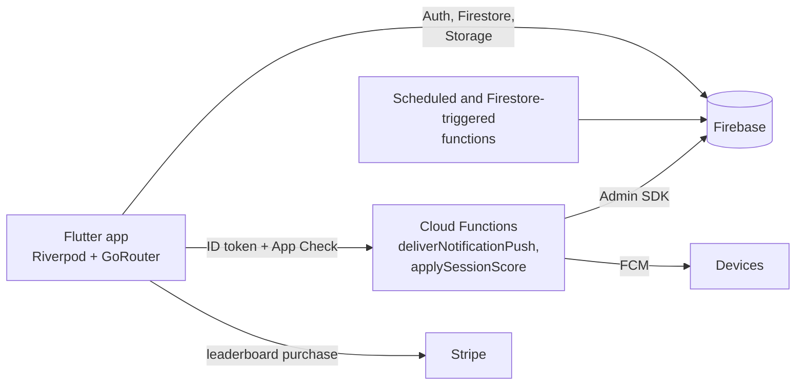

# Zyntro Flutter

[](https://github.com/a-3isa/zyntro_flutter/actions/workflows/flutter-ci.yml)

A Flutter workout-buddy app (Android and iOS) migrated from React Native. Users run solo or buddy workout sessions, follow each other, earn points and compete on leaderboards. Backend: Firebase.

Supported platforms: Android and iOS only. See [`docs/SUPPORTED_PLATFORMS.md`](docs/SUPPORTED_PLATFORMS.md).

## Architecture



Feature code lives in `lib/features/<feature>/{data,domain,presentation}` (clean architecture); shared services are in `lib/services`, and Firestore and Storage rules in `firebase/`.

## Features

- **Workout sessions**: solo or buddy; strength and cardio; live timeline with voice notes; session summary and progress charts
- **Social**: follow/follower system with privacy controls, buddy pairing, activity feed
- **Leaderboards**: free friends leaderboard; global top 50 behind a one-time $5 Stripe purchase (simulated purchase fallback for testing)
- **Points**: +10 per workout, +25 to 100 per challenge submission by difficulty, +5 per accurate judgment, +20 first-time partner support, +50 consistency bonus (5+ workouts/week)
- **Notifications**: in-app centre plus push via Firebase Cloud Messaging

## Tech stack

Flutter 3.44 (Dart 3.12+), Firebase (Auth, Firestore, Storage, Messaging, Cloud Functions), Riverpod, GoRouter, Stripe (`flutter_stripe`), FL Chart.

## Getting started

1. `git clone` the repository and run `flutter pub get`.
2. Add Firebase config files: `google-services.json` in `android/app/` and `GoogleService-Info.plist` in `ios/Runner/`.
3. Run with your Stripe publishable key:

```bash
flutter run --dart-define=STRIPE_PUBLISHABLE_KEY="$STRIPE_PUBLISHABLE_KEY"
```

Optional local fallback values: copy `.env.example` to `.env` (git-ignored, not bundled into release builds) and fill in the Firebase and Stripe values.

Deploy Firestore indexes and rules:

```bash
firebase deploy --only firestore:indexes
firebase deploy --only firestore:rules,storage
```

## Builds

```bash
flutter build apk --dart-define=ENV=dev --dart-define=STRIPE_PUBLISHABLE_KEY="$STRIPE_PUBLISHABLE_KEY"
flutter build appbundle --dart-define=ENV=prod --dart-define=STRIPE_PUBLISHABLE_KEY="$STRIPE_PUBLISHABLE_KEY" --release
flutter build ios --dart-define=ENV=prod --dart-define=STRIPE_PUBLISHABLE_KEY="$STRIPE_PUBLISHABLE_KEY" --release
```

Android release signing: create a keystore with `keytool`, copy `android/key.properties.template` to `android/key.properties`, fill in the details. App icons and splash: add `icon.png` and `splash_icon.png` to `assets/`, then run `flutter pub run flutter_launcher_icons` and `flutter pub run flutter_native_splash:create`. Releases: `./scripts/release.sh <version> <build_number>`.

## Push delivery backend

Push notifications go through the HTTPS Cloud Function `functions/deliverNotificationPush`, not a client-writable queue.

```bash
cd functions && npm install && cd ..
firebase deploy --only functions:deliverNotificationPush
```

Flow: the app writes the in-app notification under `users/{userId}/notifications`, then calls the function with the caller's Firebase ID token. The function validates the caller against Firestore, reads `users/{userId}/devices`, sends FCM through the Admin SDK and prunes invalid tokens.

## CI/CD

See [`docs/CI.md`](docs/CI.md) (audit item Z-DOC-003). On every pull request GitHub Actions runs `flutter analyze`, the unit and widget tests with a 30% line-coverage floor, the accessibility smoke test, the Cloud Functions tests and the Firestore rules tests in the emulator. Pushes to `main` also build signed Android and iOS releases and deploy the Firestore and Storage rules. Codemagic (`codemagic.yaml`) is the alternative release pipeline. Dependabot is configured but its version-update pull requests are switched off (limit 0).

## Documentation

[Privacy Policy](docs/privacy-policy.md) · [Terms of Service](docs/terms-of-service.md) · [Community Guidelines](docs/community-guidelines.md) · [Clean Architecture feature workflow](docs/clean-architecture-feature-workflow.md)

## Testing

```bash
flutter analyze
flutter test --coverage
cd functions && npm ci && npm test            # Cloud Functions unit tests
cd test/rules && npm ci && npm test           # Firestore rules (needs the Firebase emulator and Java 21)
```

## Security notes

- Firestore and Storage rules (`firebase/`) are tested in the emulator on every pull request.
- The HTTPS functions require both a Firebase ID token and an App Check token.
- The Firebase API keys in `lib/firebase_options.dart` and the Stripe *publishable* key are client identifiers, not secrets; restrict the Firebase keys in Google Cloud. Signing keys and `key.properties` are git-ignored.
- See [SECURITY.md](SECURITY.md) to report a vulnerability.

## Author

Built by Ahmed Ibrahim Hussien ([a-3isa](https://github.com/a-3isa)). No licence file: all rights reserved.
